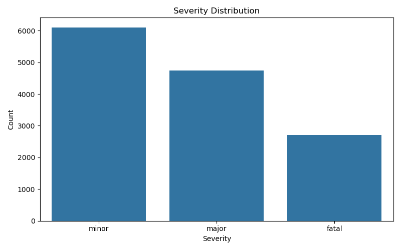
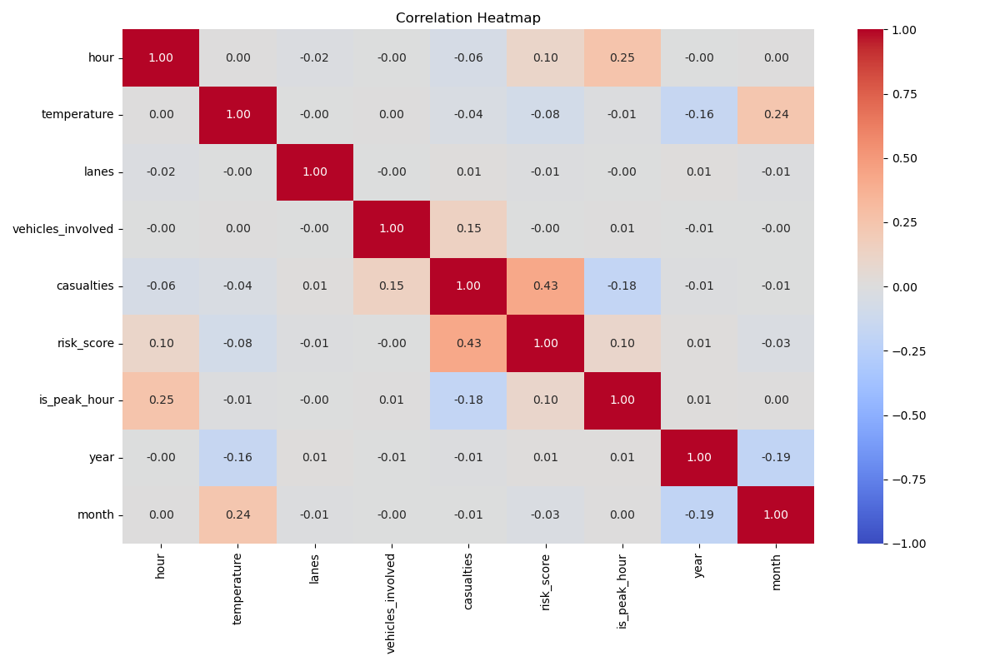
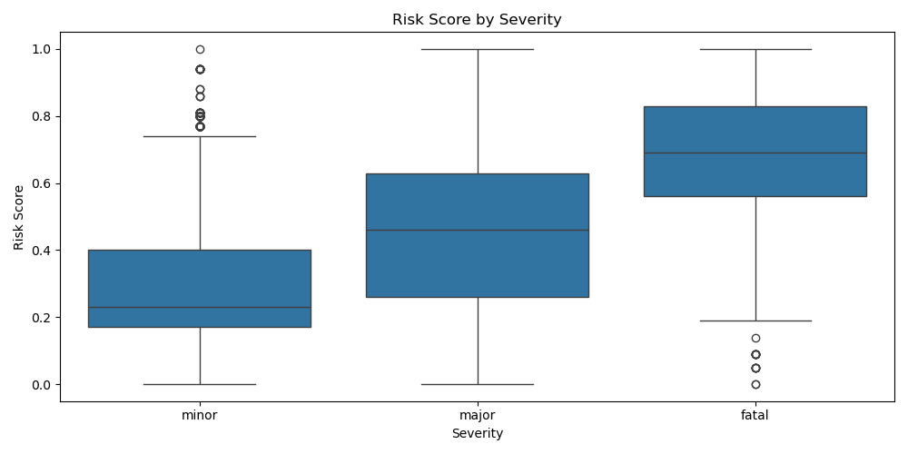
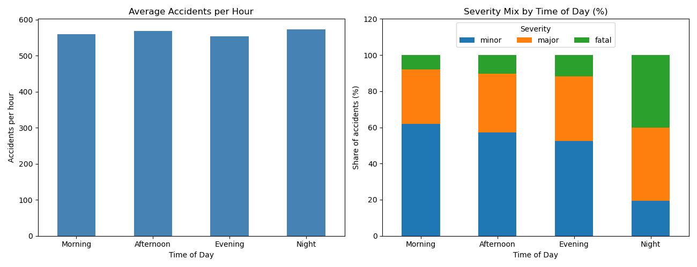

<div align="center">

# 🚦 Indian Road Accident Severity Analysis & Prediction


</div>

> **In one line:** An end-to-end data analysis and machine-learning project that finds what makes road accidents in 8 Indian cities fatal and predicts accident severity (minor / major / fatal) with **~82% accuracy**.

---

## 📑 Table of Contents

1. [Overview](#-overview)
2. [Problem Statement](#-problem-statement)
3. [Dataset](#-dataset)
4. [Tools and Technologies](#-tools-and-technologies)
5. [Methods](#-methods)
6. [Key Insights](#-key-insights)
7. [Dashboard / Model / Output](#-dashboard--model--output)
8. [How to Run This Project](#-how-to-run-this-project)
9. [Results & Conclusion](#-results--conclusion)
10. [Future Work](#-future-work)

---

## 🔎 Overview

Not every road accident is equally serious. Weather, visibility, time of day, type of road and the cause of the crash all change whether an accident ends as a minor incident or a fatal one.

This project studies **13,559 accident records from 8 Indian cities (2022-2025)** to answer two questions:

1. **Which conditions make an accident more severe?**
2. **Can the severity of an accident be predicted from those conditions?**

The whole workflow lives in a single Jupyter notebook: data loading → cleaning → feature engineering → data-leakage check → exploratory charts → descriptive statistics → probability and chi-square tests → logistic-regression model → hyper-parameter tuning → odds-ratio risk factors → robustness check → example prediction → summary export.

---

## ❓ Problem Statement

Given the road, weather, traffic, time and cause information of a reported accident:

- **Find the factors** most strongly linked to a **fatal** outcome.
- **Build a classifier** that predicts whether the accident is **minor**, **major** or **fatal**.

The model excludes the outcome columns: `casualties` (only known after the accident) and `risk_score` (a derived score that tracks severity). Using them would cause data leakage and give unrealistically good results. `cause` and `vehicles_involved` are only known once an accident has been reported, so the model predicts the severity of a *reported* accident, not accidents before they happen.

---

## 📊 Dataset

| Property | Details |
|---|---|
| **File** | `indian_roads_dataset.csv` |
| **Size** | 13,559 rows × 24 columns (23 after cleaning) |
| **Coverage** | 8 cities in 7 states: Delhi, Mumbai, Bangalore, Kolkata, Hyderabad, Chennai, Pune, Chandigarh |
| **Period** | 2022 – 2025 (1,201 distinct dates) |
| **Target column** | `accident_severity` → minor **6,102 (45.0%)**, major **4,745 (35.0%)**, fatal **2,712 (20.0%)** |
| **Missing values** | Only `festival` (99.4% empty: 13,480 of 13,559 rows). |
| **Duplicates** | None found (13,559 rows before and after cleaning) |


**Columns by group**

| Group | Columns |
|---|---|
| Identification & location | `accident_id`, `city`, `state`, `latitude`, `longitude` |
| Time | `date`, `time`, `hour`, `day_of_week`, `is_weekend`, `is_peak_hour`, `festival` (dropped in cleaning) |
| Road & traffic | `road_type` (urban / highway / rural), `lanes` (1–7), `traffic_signal` (0/1), `traffic_density` (low / medium / high) |
| Environment | `weather` (clear / rain / fog), `visibility` (high / medium / low), `temperature` (8–38 °C) |
| Accident details | `cause` (overspeeding, drunk driving, distraction, poor road, weather), `vehicles_involved` (1–5), `casualties` (0–7), `risk_score` (0–1) |
| **Target** | `accident_severity` (minor / major / fatal) |

**Features created in this project:** `year`, `month`, `time_of_day` (Morning 05–11, Afternoon 12–16, Evening 17–20, Night 21–04).

---

## 🧰 Tools and Technologies

| Category | Tools |
|---|---|
| Language | Python 3 |
| Environment | Jupyter Notebook (VS Code) |
| Data handling | pandas, NumPy |
| Visualisation | Matplotlib, Seaborn |
| Statistics | SciPy (chi-square test of independence) |
| Machine learning | scikit-learn: `Pipeline`, `ColumnTransformer`, `StandardScaler`, `OneHotEncoder`, `LogisticRegression`, `GridSearchCV`, `train_test_split`, metrics |

---

## 🧪 Methods

1. **Load & inspect** – `head`, `sample`, `shape`, `info`, `describe`, and severity counts.
2. **Clean** – drop any column with more than 50% missing values (`festival`, 99.4% empty), remove duplicates (none found), standardise the text columns (trim spaces, consistent casing), convert `date` to datetime.
3. **Feature engineering** – extract `year` and `month`, and group `hour` into `time_of_day`.
4. **Leakage check** – keep `casualties` and `risk_score` for descriptive analysis only; drop them from the model features. A check in the code confirms they are not in the model.
5. **Exploratory charts** – severity distribution, accidents by hour / time of day (average per hour and severity mix) / weather / road type / city, correlation heatmap, risk score by severity, location scatter map.
6. **Descriptive statistics** – mean, median, spread and group-wise comparison by severity.
7. **Probability & conditional risk** – P(severity | weather), P(severity | road type), P(severity | time of day), plus a joint-probability table.
8. **Chi-square tests** – test whether severity is associated with 9 categorical variables.
9. **Preprocessing** – drop `accident_id`, `date`, `time`, coordinates, `state`, `year` and the leakage columns (16 features remain); `StandardScaler` for numeric and `OneHotEncoder` for categorical columns; **80/20 stratified split** (`random_state=42`) → 10,847 train / 2,712 test rows.
10. **Modelling** – majority-class baseline vs. multi-class **Logistic Regression** in a single `Pipeline`.
11. **Tuning & interpretation** – `GridSearchCV` (stratified 5-fold, scored on macro-F1) over `C` ∈ {0.01, 0.1, 1, 10, 100} and `class_weight` ∈ {None, balanced}; odds ratios (`exp(coef)`) of the *fatal* class give the top risk factors. A **robustness check** then refits the model without `cause` and `vehicles_involved` to see how well severity can be predicted from information known before an accident happens.
12. **Summary** – findings saved to `results_summary.txt`.

---

## 💡 Key Insights

**1. Severity is moderately imbalanced** – 45% minor, 35% major, 20% fatal – so a stratified split is used.

**2. Fog, night and highways are the deadliest conditions.** Share of accidents that end as **fatal**:

| Condition | Fatal | Major | Minor |
|---|---:|---:|---:|
| **Fog** | **48.3%** | 39.6% | 12.1% |
| Rain | 26.3% | 42.6% | 31.1% |
| Clear weather | 5.9% | 28.8% | 65.2% |
| **Night (21:00–04:59)** | **40.1%** | 40.5% | 19.4% |
| Evening | 11.9% | 35.6% | 52.5% |
| Afternoon | 10.4% | 32.5% | 57.1% |
| Morning | 8.1% | 30.0% | 62.0% |
| **Highway** | **30.7%** | 40.1% | 29.2% |
| Rural road | 24.7% | 39.8% | 35.5% |
| Urban road | 9.4% | 28.8% | 61.8% |

→ A fog accident is about **8× more likely to be fatal** than one in clear weather; a night accident is about **5× more likely** than a morning one.

**3. Accidents happen at every hour.** Counts are spread almost evenly over the 24 hours (about 520–610 per hour). The *Night* bar in a plain count chart would be the tallest mainly because Night covers 8 hours (vs. 4 for Evening). The real difference at night is **severity**, not frequency.

**4. Urban roads see the most accidents** (6,039 ≈ 44.5%) **but they are the least severe**; highways are the opposite. **Delhi** has the most accidents (2,433) and **Chandigarh** the fewest.

**5. Overspeeding is the most common cause** (4,221 accidents, 31.1%). In the model, **drunk driving** and **overspeeding** are the causes most strongly linked to fatal outcomes.

**6. Chi-square tests: severity is not random.** All nine variables below are significant (p < 0.001):

| Variable | χ² | df | Result |
|---|---:|---:|---|
| weather | 3347.20 | 4 | Significant |
| visibility | 3063.12 | 4 | Significant |
| time_of_day | 2516.08 | 6 | Significant |
| road_type | 1462.11 | 4 | Significant |
| cause | 1411.74 | 8 | Significant |
| traffic_density | 1199.17 | 4 | Significant |
| traffic_signal | 971.17 | 2 | Significant |
| city | 195.63 | 14 | Significant |
| is_weekend | 50.21 | 2 | Significant |

**7. Casualties and risk score rise with severity** (mean casualties: minor 1.0 → major 3.0 → fatal 4.4; mean risk score: 0.28 → 0.46 → 0.64). This relationship is so strong that both columns are kept **out of the model** to avoid leakage.

**8. Numeric features are only weakly correlated.** Apart from casualties ↔ risk_score (r = 0.43), all pairs in the correlation heatmap have |r| of about 0.25 or less.

---


## Charts (saved to `charts/`)

| File | What it shows |
|---|---|
| `severity_distribution.png` | Count of minor / major / fatal accidents |
| `accidents_by_hour.png` | Accidents for each hour 0–23 |
| `accidents_by_time_of_day.png` | Average accidents per hour, and severity mix, for Morning / Afternoon / Evening / Night |
| `accidents_by_weather.png` | Clear / rain / fog |
| `accidents_by_road_type.png` | Urban / highway / rural |
| `accidents_by_city.png` | Accidents in each of the 8 cities |
| `correlation_heatmap.png` | Correlation of 9 numeric features |
| `risk_score_by_severity.png` | Box plot of risk score per severity class |
| `location_scatter.png` | Latitude/longitude scatter coloured by severity |
| `confusion_matrix.png` | Confusion matrix of the Logistic Regression model on the test set |

<p align="center">
  
  
</p>
<p align="center">
  
  
</p>

### Model

```python
model = Pipeline([
    ('preprocess', ColumnTransformer([
        ('num', StandardScaler(), num_cols),
        ('cat', OneHotEncoder(handle_unknown='ignore'), cat_cols)])),
    ('model', LogisticRegression(max_iter=1000))
])
```

| Model | Test accuracy |
|---|---:|
| Baseline (always predict *minor*) | 45.02% |
| Logistic Regression | 81.90% |
| **Tuned Logistic Regression** (`C=10`, `class_weight=None`) | **81.93%** |
| Robustness check: Logistic Regression without `cause` and `vehicles_involved` | 70.91% |

> **Robustness check:** the last row refits the same model using only information known before an accident happens. Accuracy drops to 70.91% (macro F1 0.6985), still far above the 45.02% baseline. The ~82% figure therefore applies to accidents that have already been *reported*.

**Per-class performance** (Logistic Regression before tuning, 2,712 test rows)

| Class | Precision | Recall | F1-score | Support |
|---|---:|---:|---:|---:|
| fatal | 0.84 | 0.81 | 0.83 | 542 |
| major | 0.73 | 0.77 | 0.75 | 949 |
| minor | 0.88 | 0.86 | 0.87 | 1,221 |
| **macro avg** | 0.82 | 0.81 | 0.82 | 2,712 |

**Confusion matrix** (Logistic Regression before tuning; rows = actual, columns = predicted)

| Actual \ Predicted | fatal | major | minor |
|---|---:|---:|---:|
| **fatal** | 439 | 103 | 0 |
| **major** | 82 | 730 | 137 |
| **minor** | 0 | 169 | 1,052 |

> ✅ No fatal accident was predicted as minor and no minor accident as fatal; all 491 mistakes involve the middle class (*major*).

**Top risk factors for a fatal outcome** (odds ratios from the tuned model; numeric features are standardised, so they are per 1 standard deviation)

| Rank | Feature | Odds ratio |
|---:|---|---:|
| 1 | `time_of_day` = Night | 12.43 |
| 2 | `cause` = drunk driving | 8.86 |
| 3 | `cause` = overspeeding | 5.76 |
| 4 | `weather` = fog | 5.66 |
| 5 | `visibility` = low | 4.68 |
| 6 | `road_type` = highway | 3.71 |
| 7 | `vehicles_involved` (numeric, per +1 SD) | 3.19 |
| 8 | `traffic_density` = low | 2.11 |
| 9 | `city` = Delhi | 2.06 |
| 10 | `city` = Kolkata | 1.50 |

**Example predictions** (tuned model)

| Scenario | Predicted severity | Probability of predicted class |
|---|---|---:|
| High risk: Delhi, Monday 03:00, 4-lane highway, fog, low visibility, drunk driving | fatal | 1.00 |
| Low risk: Delhi, Monday 14:00, 4-lane urban road, clear weather, high visibility, distraction | minor | 1.00 |

**Saved summary (`results_summary.txt`)** – seven lines generated from the data: the cleaning rule applied, fatal shares for fog, night and highways versus their counterparts, baseline versus model accuracy, the five features most linked to fatal outcomes, and a note that these are associations, not proof of cause.

---

## 💻 How to Run This Project

**1. Clone the repository**

```bash
git clone https://github.com/lokeshdata/Indian_road_accident_project.git
cd Indian_road_accident_project
```

**2. (Optional) create a virtual environment**

```bash
python -m venv venv
venv\Scripts\activate          # Windows
# source venv/bin/activate     # macOS / Linux
```

**3. Install the dependencies**

```bash
pip install pandas numpy matplotlib seaborn scipy scikit-learn jupyter
```

**4. Add the dataset**

Place `indian_roads_dataset.csv` in the same folder as the notebook.

**5. Open and run the notebook**

```bash
jupyter notebook indian_road_accident_project.ipynb
```

Choose **Run All** (or open it in VS Code and click **Run All**). Running the notebook creates the `charts/` folder and `results_summary.txt`.

**Project structure**

```
Indian_road_accident_project/
├── indian_road_accident_project.ipynb   # full analysis + model
├── indian_roads_dataset.csv             # dataset (13,559 × 24)
├── README.md
├── results_summary.txt                  # generated
└── charts/                              # generated
    ├── severity_distribution.png
    ├── accidents_by_hour.png
    ├── accidents_by_time_of_day.png
    ├── accidents_by_weather.png
    ├── accidents_by_road_type.png
    ├── accidents_by_city.png
    ├── correlation_heatmap.png
    ├── risk_score_by_severity.png
    ├── location_scatter.png
    └── confusion_matrix.png
```

---

## 🏁 Results & Conclusion

- The tuned Logistic Regression reaches **81.9% accuracy** against a **45.0%** majority-class baseline, with a macro F1-score of **0.82**.
- With the untuned model, **fatal accidents** are predicted with **0.84 precision and 0.81 recall**; fatal and minor accidents were never confused with each other in the test set, so all 491 errors involve the middle class (*major*).
- Hyper-parameter tuning (best: `C=10`, `class_weight=None`) changed accuracy by less than **0.1 percentage point** (81.90% → 81.93%), which suggests the simple linear model already captures most of the signal in this data.
- **Night driving, fog, low visibility, highways, drunk driving and overspeeding** are the conditions most strongly linked to severe accidents.
- Leakage was controlled by excluding `casualties` and `risk_score`. Because `cause` and `vehicles_involved` are only known once an accident has been reported, the model predicts the severity of reported accidents rather than forecasting them in advance. A robustness check without those two columns still reaches **70.9% accuracy** (macro F1 **0.70**) against the 45.0% baseline.

---

## 🚀 Future Work

- Compare with non-linear models (Random Forest, XGBoost, LightGBM) and report per-class results for each.
- Handle class imbalance more explicitly (e.g., SMOTE or a tuned decision threshold; `class_weight='balanced'` was already tried in the grid search) to push **fatal recall** higher.
- Validate on **real** accident records (e.g., MoRTH / NCRB / state police data) and use a **time-based** train/test split.
- Add model explainability with **SHAP** for individual predictions.
- Build an interactive **Streamlit / Power BI dashboard** with city maps and filters.
- Run **hotspot detection** on latitude/longitude with DBSCAN or K-Means.
- Deploy the model as a **REST API / web app** and feed it live weather and traffic data.

---

⭐ If you found this project useful, consider giving the repository a star!
