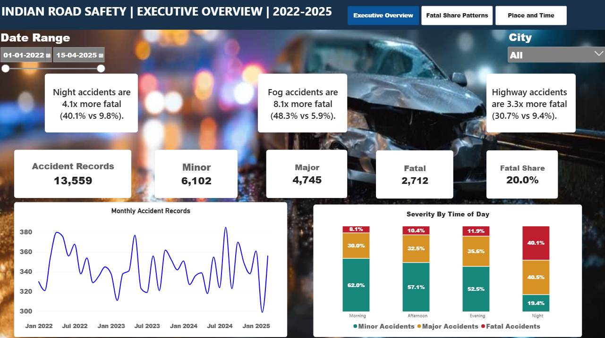
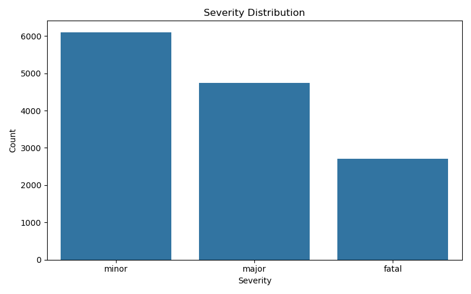
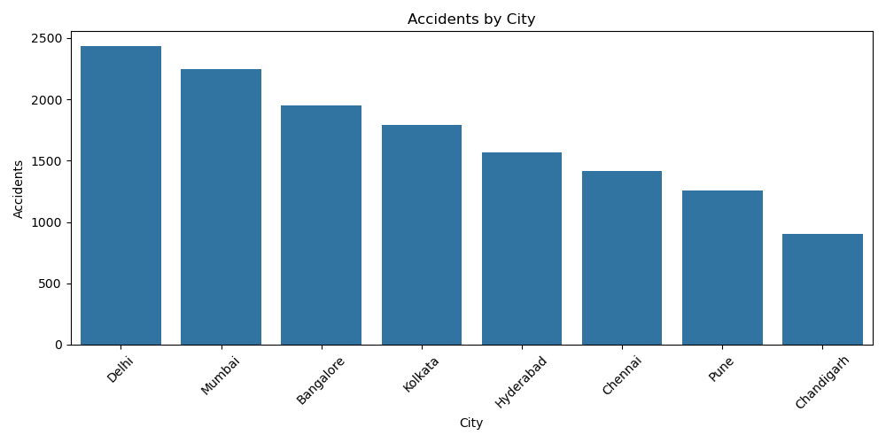
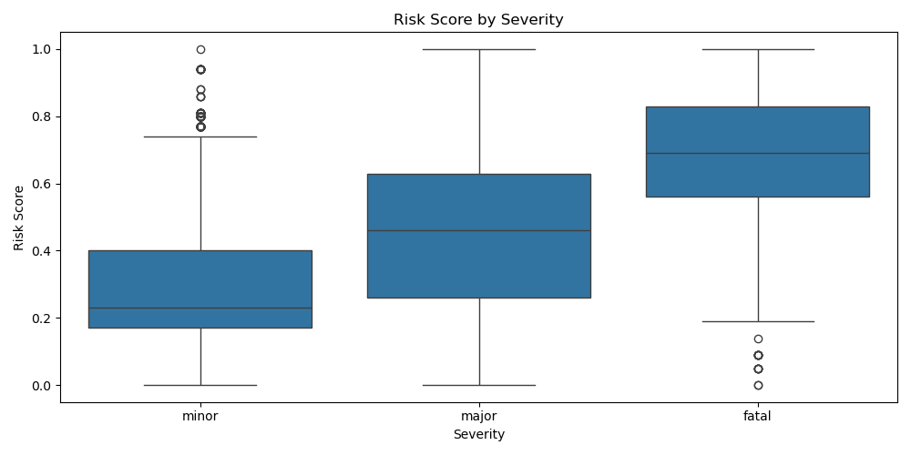
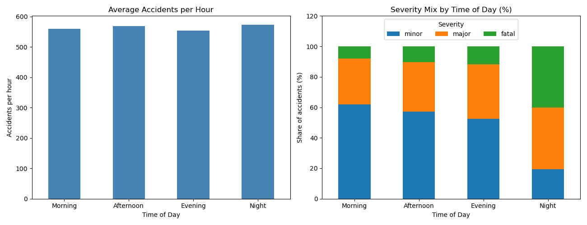
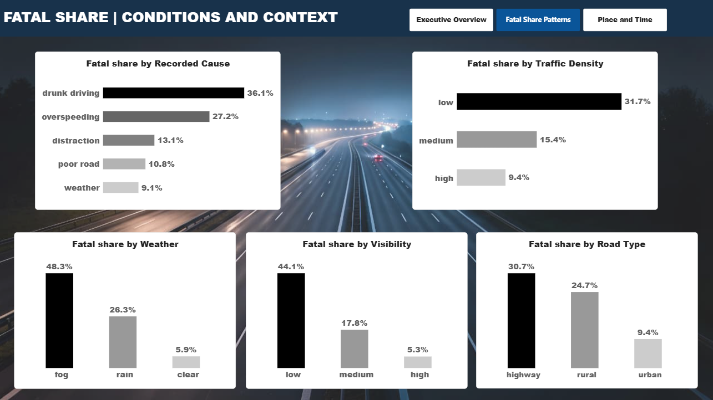
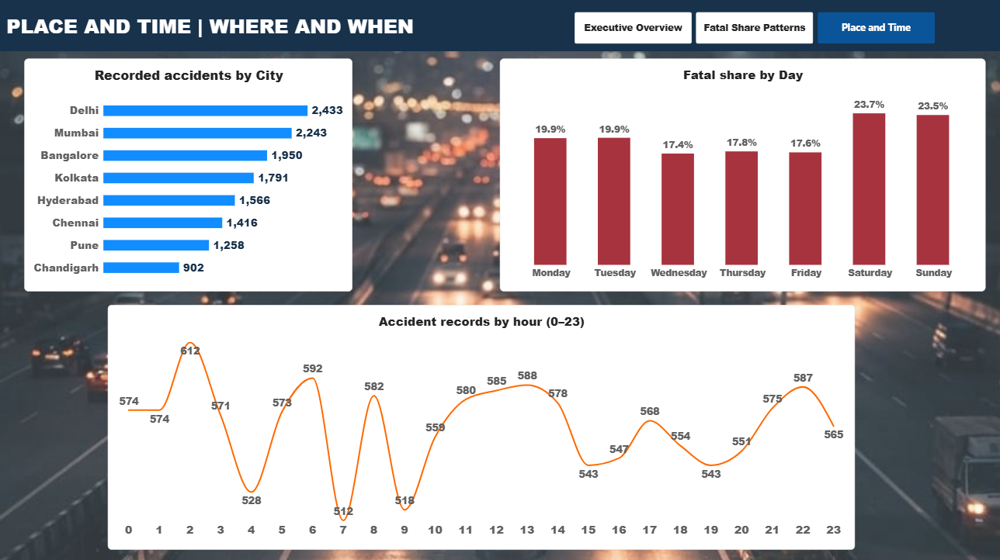

<div align="center">

# 🚦 Indian Road Accident Severity Analysis & Prediction

**Python · Machine Learning · Power BI**


</div>

> **In one line:** An end-to-end analytics project on 13,559 road-accident records from 8 Indian cities: a **Python** analysis and machine-learning model that predicts accident severity (minor / major / fatal) with **~82% accuracy**, plus a **3-page interactive Power BI dashboard** that shows where, when and under which conditions accidents turn fatal.

<p align="center">
  
</p>

<p align="center">
  <b>Jump to:</b>
  <a href="#-power-bi-dashboard">Dashboard</a> ·
  <a href="#-key-insights">Key insights</a> ·
  <a href="#-machine-learning-results">Model results</a> ·
  <a href="#-how-to-run-this-project">How to run</a>
  <br>
  <b>Dashboard files:</b>
  <a href="Indian_Road_Accident_Dashboard.pdf">📄 View as PDF</a> ·
  <a href="Indian_Road_Accident_Dashboard.pbix">📥 Download the Power BI file (.pbix)</a>
</p>

---

## 📑 Table of Contents

1. [Overview](#-overview)
2. [Problem Statement](#-problem-statement)
3. [Dataset](#-dataset)
4. [Tools and Technologies](#-tools-and-technologies)
5. [Methods](#-methods)
6. [Key Insights](#-key-insights)
7. [Machine Learning Results](#-machine-learning-results)
8. [Power BI Dashboard](#-power-bi-dashboard)
9. [How to Run This Project](#-how-to-run-this-project)
10. [Results & Conclusion](#-results--conclusion)
11. [Limitations](#-limitations)
12. [Future Work](#-future-work)
13. [Author](#-author)

---

## 🔎 Overview

Not every road accident is equally serious. Weather, visibility, time of day, type of road and the cause of the crash all change whether an accident ends as a minor incident or a fatal one.

This project studies **13,559 accident records from 8 Indian cities (Jan 2022 – Apr 2025)** to answer three questions:

1. **Which conditions make an accident more severe?**
2. **Can the severity of an accident be predicted from those conditions?**
3. **Where and when do accidents happen, and how can a non-technical reader explore the answers?**

The same dataset is analysed with two complementary tools:

| | 🐍 Python (Jupyter notebook) | 📊 Power BI (dashboard) |
|---|---|---|
| **Question** | *Why* are some accidents fatal, and can severity be predicted? | *Where, when and under which conditions* do accidents turn fatal? |
| **Techniques** | Cleaning, feature engineering, leakage check, chi-square tests, Logistic Regression, tuning, odds ratios | Power Query cleaning, DAX measures, slicers, KPI cards, dynamic insight text |
| **Result** | **81.93%** test accuracy vs a 45.02% baseline | 3 interactive pages whose figures match the notebook |
| **File** | `indian_road_accident_project.ipynb` | `Indian_Road_Accident_Dashboard.pbix` (plus a PDF export, `Indian_Road_Accident_Dashboard.pdf`) |

```text
Python    CSV → clean → engineer features → leakage check → EDA → χ² tests → Logistic Regression → tuning → odds ratios → results_summary.txt
Power BI  CSV → Power Query clean → add columns → DAX measures → 3 report pages → slicers & navigation → validate against the notebook
```

Both parts use the same cleaning rules and definitions (for example the `time_of_day` groups), so they tell one consistent story.

---

## ❓ Problem Statement

Given the road, weather, traffic, time and cause information of a reported accident:

- **Find the factors** most strongly linked to a **fatal** outcome.
- **Build a classifier** that predicts whether the accident is **minor**, **major** or **fatal**.
- **Communicate the findings** in an interactive dashboard where a reader can filter by date and city and compare fatal shares across conditions, places and times.

The model excludes the outcome columns: `casualties` (only known after the accident) and `risk_score` (a derived score that tracks severity). Using them would cause data leakage and give unrealistically good results. `cause` and `vehicles_involved` are only known once an accident has been reported, so the model predicts the severity of a *reported* accident, not accidents before they happen.

---

## 📊 Dataset

| Property | Details |
|---|---|
| **File** | `indian_roads_dataset.csv` |
| **Size** | 13,559 rows × 24 columns (23 after cleaning) |
| **Coverage** | 8 cities in 7 states: Delhi, Mumbai, Bangalore, Kolkata, Hyderabad, Chennai, Pune, Chandigarh |
| **Period** | 1 Jan 2022 – 15 Apr 2025 (1,201 distinct dates; April 2025 is a partial month) |
| **Target column** | `accident_severity` → minor **6,102 (45.0%)**, major **4,745 (35.0%)**, fatal **2,712 (20.0%)** |
| **Missing values** | Only `festival` (99.4% empty: 13,480 of 13,559 rows). |
| **Duplicates** | None found (13,559 rows before and after cleaning; no repeated `accident_id`) |

**Columns by group**

| Group | Columns |
|---|---|
| Identification & location | `accident_id`, `city`, `state`, `latitude`, `longitude` |
| Time | `date`, `time`, `hour`, `day_of_week`, `is_weekend`, `is_peak_hour`, `festival` (dropped in cleaning) |
| Road & traffic | `road_type` (urban / highway / rural), `lanes` (1–7), `traffic_signal` (0/1), `traffic_density` (low / medium / high) |
| Environment | `weather` (clear / rain / fog), `visibility` (high / medium / low), `temperature` (8–38 °C) |
| Accident details | `cause` (overspeeding, drunk driving, distraction, poor road, weather), `vehicles_involved` (1–5), `casualties` (0–7), `risk_score` (0–1) |
| **Target** | `accident_severity` (minor / major / fatal) |

**Features created in this project**

| Where | New columns |
|---|---|
| Python | `year`, `month`, `time_of_day` |
| Power BI | `time_of_day` (same rule), `month_start` (first day of each month, for the monthly trend) and three hidden sort-helper columns: `time_of_day_sort`, `severity_sort`, `day_of_week_sort` |

`time_of_day` is defined identically in both tools: Morning 05–11 (7 hours), Afternoon 12–16 (5 hours), Evening 17–20 (4 hours), Night 21–04 (8 hours).

---

## 🧰 Tools and Technologies

| Category | Tools |
|---|---|
| Languages | Python 3, DAX, Power Query (M) |
| Environments | Jupyter Notebook (VS Code), Power BI Desktop (Windows) |
| Data handling | pandas, NumPy (Python); Power Query (Power BI) |
| Visualisation | Matplotlib, Seaborn (Python); Power BI visuals: KPI cards, line, bar, column and 100% stacked column charts, slicers, page navigator |
| Statistics | SciPy (chi-square test of independence) |
| Machine learning | scikit-learn: `Pipeline`, `ColumnTransformer`, `StandardScaler`, `OneHotEncoder`, `LogisticRegression`, `GridSearchCV`, `train_test_split`, metrics |
| Dashboard logic | DAX measures using `CALCULATE`, `DIVIDE`, `REMOVEFILTERS` and `FORMAT` |

---

## 🧪 Methods

### Part A: Python analysis and machine learning

1. **Load & inspect** – `head`, `sample`, `shape`, `info`, `describe`, and severity counts.
2. **Clean** – drop any column with more than 50% missing values (`festival`, 99.4% empty), remove duplicates (none found), standardise the text columns (trim spaces, consistent casing), convert `date` to datetime.
3. **Feature engineering** – extract `year` and `month`, and group `hour` into `time_of_day`.
4. **Leakage check** – keep `casualties` and `risk_score` for descriptive analysis only; drop them from the model features. A check in the code confirms they are not in the model.
5. **Exploratory charts** – severity distribution, accidents by hour / time of day (average per hour and severity mix) / weather / road type / city, correlation heatmap, risk score by severity, location scatter map.
6. **Descriptive statistics** – mean, median, spread and group-wise comparison by severity.
7. **Probability & conditional risk** – P(severity | weather), P(severity | road type), P(severity | time of day), plus a joint-probability table.
8. **Chi-square tests** – test whether severity is associated with 9 categorical variables.
9. **Preprocessing** – drop `accident_id`, `date`, `time`, coordinates, `state`, `year` and the leakage columns (16 features remain); `StandardScaler` for numeric and `OneHotEncoder` for categorical columns; **80/20 stratified split** (`random_state=42`) → 10,847 train / 2,712 test rows.
10. **Modelling** – majority-class baseline vs. multi-class **Logistic Regression** in a single `Pipeline`.
11. **Tuning & interpretation** – `GridSearchCV` (stratified 5-fold, scored on macro-F1) over `C` ∈ {0.01, 0.1, 1, 10, 100} and `class_weight` ∈ {None, balanced}; odds ratios (`exp(coef)`) of the *fatal* class give the top risk factors. A **robustness check** then refits the model without `cause` and `vehicles_involved` to see how well severity can be predicted from information known before an accident happens.
12. **Summary** – findings saved to `results_summary.txt`.

### Part B: Power BI dashboard

1. **Import** – loaded `indian_roads_dataset.csv` with *Get data → Text/CSV* into a query named `Accidents`. (Power Query's "999+ rows" is only a preview sample; the loaded table holds all 13,559 rows.)
2. **Clean in Power Query** – removed `festival` (99.4% empty, the same rule as the notebook), set the correct data types (whole numbers, decimals, `date`) and checked for errors and accidental filters.
3. **Add columns** – `time_of_day` (same four groups as the notebook), `month_start` (for a clean monthly trend) and three hidden sort helpers so weekdays, time of day and severity appear in logical order (Mon → Sun, Morning → Night, Minor → Major → Fatal).
4. **Write DAX measures** – counts by severity, **Fatal Share**, group comparisons (night vs other times, fog vs clear, highway vs urban) and dynamic text for the insight cards.
5. **Design** – dark-navy header, white visual cards on photo backgrounds, one colour code for severity (teal = minor, amber = major, red = fatal) and a black-to-grey scale on the fatal-share charts (darker = higher share).
6. **Build three pages** – *Executive Overview* (what happened), *Fatal Share Patterns* (under which conditions) and *Place and Time* (where and when); add page-navigation buttons and the date and city slicers.
7. **Validate** – compare every headline number with the notebook output (see the [cross-check table](#python-vs-power-bi-cross-check)).

---

## 💡 Key Insights

> **How to read "fatal share":** the percentage of recorded accidents in a group that ended as *fatal*. It compares severity, not how many accidents happened, and it describes this dataset only: it shows association, not causation.

**1. Severity is moderately imbalanced** – 45% minor, 35% major, 20% fatal – so a stratified split is used.

**2. Fog, night and highways are the deadliest conditions.** Share of accidents that end as **fatal**:

| Condition | Fatal | Major | Minor |
|---|---:|---:|---:|
| **Fog** | **48.3%** | 39.6% | 12.1% |
| Rain | 26.3% | 42.6% | 31.1% |
| Clear weather | 5.9% | 28.8% | 65.2% |
| **Night (21:00–04:59)** | **40.1%** | 40.5% | 19.4% |
| Evening | 11.9% | 35.6% | 52.5% |
| Afternoon | 10.4% | 32.5% | 57.1% |
| Morning | 8.1% | 30.0% | 62.0% |
| **Highway** | **30.7%** | 40.1% | 29.2% |
| Rural road | 24.7% | 39.8% | 35.5% |
| Urban road | 9.4% | 28.8% | 61.8% |

→ Relative to their counterparts, fog has **8.1×** the fatal share of clear weather (48.3% vs 5.9%), night has **4.1×** that of all other hours combined (40.1% vs 9.8%; about 5× the morning share) and highways have **3.3×** that of urban roads (30.7% vs 9.4%). These are the three insight cards on the dashboard's first page. Ratios use unrounded shares, so they can differ slightly from dividing the rounded percentages.

**3. Accidents happen at every hour.** Counts are spread almost evenly over the 24 hours (between **512** at 07:00 and **612** at 02:00). The *Night* bar in a plain count chart would be the tallest mainly because Night covers 8 hours (vs. 4 for Evening). The real difference at night is **severity**, not frequency.

**4. Urban roads see the most accidents** (6,039 ≈ 44.5%) **but they are the least severe**; highways are the opposite. **Delhi** has the most accidents (2,433) and **Chandigarh** the fewest (902). These are record counts, not per-capita rates.

**5. Overspeeding is the most common cause** (4,221 accidents, 31.1%), but **drunk driving is the deadliest**: 36.1% of drunk-driving accidents are fatal, against 27.2% for overspeeding, 13.1% for distraction, 10.8% for poor road and 9.1% for weather. The model agrees: drunk driving and overspeeding have the highest fatal odds ratios among the causes.

**6. Chi-square tests: severity is not random.** All nine variables below are significant (p < 0.001):

| Variable | χ² | df | Result |
|---|---:|---:|---|
| weather | 3347.20 | 4 | Significant |
| visibility | 3063.12 | 4 | Significant |
| time_of_day | 2516.08 | 6 | Significant |
| road_type | 1462.11 | 4 | Significant |
| cause | 1411.74 | 8 | Significant |
| traffic_density | 1199.17 | 4 | Significant |
| traffic_signal | 971.17 | 2 | Significant |
| city | 195.63 | 14 | Significant |
| is_weekend | 50.21 | 2 | Significant |

**7. Casualties and risk score rise with severity** (mean casualties: minor 1.0 → major 3.0 → fatal 4.4; mean risk score: 0.28 → 0.46 → 0.64). This relationship is so strong that both columns are kept **out of the model** to avoid leakage.

**8. Numeric features are only weakly correlated.** Apart from casualties ↔ risk_score (r = 0.43), all pairs in the correlation heatmap have |r| of about 0.25 or less.

**9. Weekends are deadlier.** The fatal share peaks on Saturday (23.7%) and Sunday (23.5%), against 17.4–19.9% on weekdays (see the *Place and Time* page of the dashboard). `is_weekend` is also significant in the chi-square test above.

**10. Poor visibility and light traffic go with more severe accidents.** Fatal share is 44.1% in low visibility, 17.8% in medium and 5.3% in high. It is 31.7% when traffic density is low, 15.4% when medium and 9.4% when high, and *low* traffic density is also among the model's top risk factors (odds ratio 2.11). A plausible reason is higher speeds on emptier roads, but that is a hypothesis this data cannot confirm.

**11. Monthly volume is steady.** The dashboard's monthly trend stays between roughly 300 and 385 records a month from January 2022 to March 2025, with no obvious long-term rise or fall. The dataset ends on 15 April 2025, so April 2025 is a partial month (160 records).

### Exploratory charts (saved to `charts/`)

| File | What it shows |
|---|---|
| `severity_distribution.png` | Count of minor / major / fatal accidents |
| `accidents_by_hour.png` | Accidents for each hour 0–23 |
| `accidents_by_time_of_day.png` | Average accidents per hour, and severity mix, for Morning / Afternoon / Evening / Night |
| `accidents_by_weather.png` | Clear / rain / fog |
| `accidents_by_road_type.png` | Urban / highway / rural |
| `accidents_by_city.png` | Accidents in each of the 8 cities |
| `correlation_heatmap.png` | Correlation of 9 numeric features |
| `risk_score_by_severity.png` | Box plot of risk score per severity class |
| `location_scatter.png` | Latitude/longitude scatter coloured by severity |
| `confusion_matrix.png` | Confusion matrix of the Logistic Regression model on the test set |

<p align="center">
  
  
</p>
<p align="center">
  
  
</p>

---

## 🤖 Machine Learning Results

### Model

```python
model = Pipeline([
    ('preprocess', ColumnTransformer([
        ('num', StandardScaler(), num_cols),
        ('cat', OneHotEncoder(handle_unknown='ignore'), cat_cols)])),
    ('model', LogisticRegression(max_iter=1000))
])
```

### Test accuracy

| Model | Test accuracy | Macro F1 |
|---|---:|---:|
| Baseline (always predict *minor*) | 45.02% | – |
| Logistic Regression | 81.90% | 0.8158 |
| **Tuned Logistic Regression** (`C=10`, `class_weight=None`) | **81.93%** | **0.8161** |
| Robustness check: Logistic Regression without `cause` and `vehicles_involved` | 70.91% | 0.6985 |

> **Robustness check:** the last row refits the same model using only information known before an accident happens. Accuracy drops to 70.91% (macro F1 0.6985), still far above the 45.02% baseline. The ~82% figure therefore applies to accidents that have already been *reported*.

**Per-class performance** (Logistic Regression before tuning, 2,712 test rows)

| Class | Precision | Recall | F1-score | Support |
|---|---:|---:|---:|---:|
| fatal | 0.84 | 0.81 | 0.83 | 542 |
| major | 0.73 | 0.77 | 0.75 | 949 |
| minor | 0.88 | 0.86 | 0.87 | 1,221 |
| **macro avg** | 0.82 | 0.81 | 0.82 | 2,712 |

**Confusion matrix** (Logistic Regression before tuning; rows = actual, columns = predicted)

| Actual \ Predicted | fatal | major | minor |
|---|---:|---:|---:|
| **fatal** | 439 | 103 | 0 |
| **major** | 82 | 730 | 137 |
| **minor** | 0 | 169 | 1,052 |

> ✅ No fatal accident was predicted as minor and no minor accident as fatal; all 491 mistakes involve the middle class (*major*).

**Top risk factors for a fatal outcome** (odds ratios from the tuned model; numeric features are standardised, so they are per 1 standard deviation)

| Rank | Feature | Odds ratio |
|---:|---|---:|
| 1 | `time_of_day` = Night | 12.43 |
| 2 | `cause` = drunk driving | 8.86 |
| 3 | `cause` = overspeeding | 5.76 |
| 4 | `weather` = fog | 5.66 |
| 5 | `visibility` = low | 4.68 |
| 6 | `road_type` = highway | 3.71 |
| 7 | `vehicles_involved` (numeric, per +1 SD) | 3.19 |
| 8 | `traffic_density` = low | 2.11 |
| 9 | `city` = Delhi | 2.06 |
| 10 | `city` = Kolkata | 1.50 |

**Example predictions** (tuned model)

| Scenario | Predicted severity | Probability of predicted class |
|---|---|---:|
| High risk: Delhi, Monday 03:00, 4-lane highway, fog, low visibility, drunk driving | fatal | 1.00 |
| Low risk: Delhi, Monday 14:00, 4-lane urban road, clear weather, high visibility, distraction | minor | 1.00 |

**Saved summary (`results_summary.txt`)** – seven lines generated from the data: the cleaning rule applied, fatal shares for fog, night and highways versus their counterparts, baseline versus model accuracy, the five features most linked to fatal outcomes, and a note that these are associations, not proof of cause.

---

## 📈 Power BI Dashboard

The dashboard turns the same data into an interactive report for non-technical readers. It has **three pages**, linked by navigation buttons in the header. Its KPI cards, insight sentences and charts are driven by DAX measures, and on the first page the **Date range** and **City** slicers update them instantly.

> 📄 **No Power BI Desktop?** Open the [PDF export](Indian_Road_Accident_Dashboard.pdf) to see every page. To try the filters yourself, download [`Indian_Road_Accident_Dashboard.pbix`](Indian_Road_Accident_Dashboard.pbix) and open it in Power BI Desktop (free, Windows).

| Page | Question it answers | Main visuals |
|---|---|---|
| **1. Executive Overview** | How many accidents are there, how severe are they, and how does severity change through the day? | Date and city slicers, 3 insight cards, 5 KPI cards, monthly trend line, severity mix by time of day |
| **2. Fatal Share Patterns** | Under which conditions is an accident most likely to be fatal? | Fatal share by recorded cause, traffic density, weather, visibility and road type |
| **3. Place and Time** | Where and when do accidents happen? | Records by city, fatal share by day of week, records by hour of day |

### Page 1: Executive Overview

<p align="center">
  
</p>

- **Slicers:** a Date range (1 Jan 2022 – 15 Apr 2025) and a City dropdown (default: All).
- **Three insight cards**, written as DAX text measures so the numbers follow the filters: night has **4.1×** the fatal share of all other hours (40.1% vs 9.8%), fog **8.1×** that of clear weather (48.3% vs 5.9%) and highways **3.3×** that of urban roads (30.7% vs 9.4%).
- **Five KPI cards:** Accident Records **13,559**, Minor **6,102**, Major **4,745**, Fatal **2,712** and Fatal Share **20.0%**.
- **Monthly Accident Records:** a trend line from Jan 2022 to Mar 2025 that stays between roughly 300 and 385 records a month.
- **Severity by Time of Day:** a 100% stacked column chart in which the fatal share grows from 8.1% in the morning to 10.4% in the afternoon, 11.9% in the evening and 40.1% at night.

### Page 2: Fatal Share Patterns

<p align="center">
  
</p>

Each chart shows the **fatal share** for one factor, and **the darker the bar, the higher the share**.

| Chart | Fatal share, highest → lowest |
|---|---|
| Recorded cause | drunk driving 36.1% · overspeeding 27.2% · distraction 13.1% · poor road 10.8% · weather 9.1% |
| Traffic density | low 31.7% · medium 15.4% · high 9.4% |
| Weather | fog 48.3% · rain 26.3% · clear 5.9% |
| Visibility | low 44.1% · medium 17.8% · high 5.3% |
| Road type | highway 30.7% · rural 24.7% · urban 9.4% |

**Takeaway:** the highest fatal shares go with fog, low visibility, drunk driving, light traffic and highways.

### Page 3: Place and Time

<p align="center">
  
</p>

- **Recorded accidents by city:** Delhi 2,433 · Mumbai 2,243 · Bangalore 1,950 · Kolkata 1,791 · Hyderabad 1,566 · Chennai 1,416 · Pune 1,258 · Chandigarh 902.
- **Fatal share by day:** Saturday (23.7%) and Sunday (23.5%) are the highest; weekdays range from 17.4% to 19.9%.
- **Accident records by hour (0–23):** counts stay between 512 (hour 7) and 612 (hour 2), so accidents are not concentrated at one time of day.

**Takeaway:** accident *frequency* is spread evenly across the day, but *severity* is not.

### Interactivity

- **Date range and City slicers** (Executive Overview) recalculate the KPI cards, the insight sentences, the trend line and the severity chart.
- **Page buttons** in the header jump between the three pages.
- **Logical ordering everywhere:** weekdays run Monday → Sunday, time of day Morning → Night, hours 0 → 23 and severity Minor → Major → Fatal.

### Core DAX measures

<details>
<summary><b>Show the main measures</b> (simplified)</summary>

```DAX
Accident Count = COUNTROWS(Accidents)

Fatal Accidents =
CALCULATE([Accident Count], Accidents[accident_severity] = "fatal")

Fatal Share = DIVIDE([Fatal Accidents], [Accident Count])

// Fatal share of night accidents, whatever other time-of-day filter is active
Night Fatal Share =
CALCULATE([Fatal Share], REMOVEFILTERS(Accidents[time_of_day]), Accidents[time_of_day] = "Night")

Other Times Fatal Share =
CALCULATE([Fatal Share], REMOVEFILTERS(Accidents[time_of_day]), Accidents[time_of_day] <> "Night")

Night vs Other Ratio = DIVIDE([Night Fatal Share], [Other Times Fatal Share])

// Text shown on the insight card; it recalculates with the slicers
Night Insight =
"Night accidents are " & FORMAT([Night vs Other Ratio], "0.0") & "x more fatal ("
    & FORMAT([Night Fatal Share], "0.0%") & " vs " & FORMAT([Other Times Fatal Share], "0.0%") & ")."
```

`Minor Accidents` and `Major Accidents` mirror `Fatal Accidents`. The Fog (vs clear weather) and Highway (vs urban road) insight cards follow the same pattern as the Night card.

</details>

### Design decisions

- **Shares, not raw counts.** Groups differ in size (Night covers 8 hours, Evening only 4), so the charts compare *fatal share* instead of how many records each group has.
- **Severity mix as a 100% stacked chart.** It shows how the make-up of accidents shifts through the day without letting group size dominate.
- **Date and city are the only slicers.** A severity slicer would remove classes from the denominator and distort every share.
- **Consistent colour language.** Teal = minor, amber = major and red = fatal on severity charts; on the fatal-share charts a black-to-grey scale marks the highest to the lowest share.
- **Calculated, not typed, insights.** The comparison sentences are DAX measures, so they stay correct after filtering.
- **One definition across tools.** `time_of_day`, the cleaning rules and the severity labels match the notebook.

### Python vs Power BI cross-check

Every headline number on the dashboard was compared with the notebook output:

| Metric | Python notebook | Power BI dashboard |
|---|---:|---:|
| Accident records | 13,559 | 13,559 |
| Minor / Major / Fatal | 6,102 / 4,745 / 2,712 | 6,102 / 4,745 / 2,712 |
| Overall fatal share | 20.0% | 20.0% |
| Fatal share: fog | 48.3% | 48.3% |
| Fatal share: night | 40.1% | 40.1% |
| Fatal share: highway | 30.7% | 30.7% |
| Records in Delhi (most of any city) | 2,433 | 2,433 |

Identical results confirm that the Power BI cleaning steps (dropping `festival`, building `time_of_day`) reproduce the notebook's data.

---

## 💻 How to Run This Project

### A. Python notebook

**1. Clone the repository**

```bash
git clone https://github.com/lokeshdata/Indian_road_accident_project.git
cd Indian_road_accident_project
```

**2. (Optional) create a virtual environment**

```bash
python -m venv venv
venv\Scripts\activate          # Windows
# source venv/bin/activate     # macOS / Linux
```

**3. Install the dependencies**

```bash
pip install pandas numpy matplotlib seaborn scipy scikit-learn jupyter
```

**4. Add the dataset**

Place `indian_roads_dataset.csv` in the same folder as the notebook (it is already there if you cloned the repository).

**5. Open and run the notebook**

```bash
jupyter notebook indian_road_accident_project.ipynb
```

Choose **Run All** (or open it in VS Code and click **Run All**). Running the notebook creates the `charts/` folder and `results_summary.txt`.

### B. Power BI dashboard

1. Install **Power BI Desktop** (free, Windows only) from the Microsoft Store or microsoft.com. No sign-in is needed to open a local file.
2. Open `Indian_Road_Accident_Dashboard.pbix` (*File → Open report*, or double-click the file).
3. Use the buttons in the header to switch pages, and the **Date range** and **City** slicers on the Executive Overview page to filter.
4. *Optional, only if you want to refresh the data:* the `.pbix` already contains the imported data, so every visual works as soon as it opens. **Refresh** makes Power BI look for the CSV at the path where it was first imported. To point it at your copy, go to *Home → Transform data → Data source settings → Change Source…* and select `indian_roads_dataset.csv`.
5. On macOS or Linux, or without Power BI Desktop, use the [PDF export](Indian_Road_Accident_Dashboard.pdf) or the screenshots in the [dashboard section](#-power-bi-dashboard).

**Project structure**

```text
Indian_road_accident_project/
├── indian_road_accident_project.ipynb    # Python: full analysis + model
├── Indian_Road_Accident_Dashboard.pbix   # Power BI: 3-page interactive dashboard
├── Indian_Road_Accident_Dashboard.pdf    # PDF export of the dashboard
├── indian_roads_dataset.csv              # dataset (13,559 × 24)
├── README.md
├── results_summary.txt                   # generated by the notebook
├── charts/                               # generated by the notebook
│   ├── severity_distribution.png
│   ├── accidents_by_hour.png
│   ├── accidents_by_time_of_day.png
│   ├── accidents_by_weather.png
│   ├── accidents_by_road_type.png
│   ├── accidents_by_city.png
│   ├── correlation_heatmap.png
│   ├── risk_score_by_severity.png
│   ├── location_scatter.png
│   └── confusion_matrix.png
└── powerbi_screenshots/                  # dashboard page images used in this README
    ├── 01-executive-overview.png
    ├── 02-fatal-share-patterns.png
    └── 03-place-and-time.png
```

---

## 🏁 Results & Conclusion

- The tuned Logistic Regression reaches **81.9% accuracy** against a **45.0%** majority-class baseline, with a macro F1-score of **0.82** (0.8161).
- With the untuned model, **fatal accidents** are predicted with **0.84 precision and 0.81 recall**; fatal and minor accidents were never confused with each other in the test set, so all 491 errors involve the middle class (*major*).
- Hyper-parameter tuning (best: `C=10`, `class_weight=None`) changed accuracy by less than **0.1 percentage point** (81.90% → 81.93%), which suggests the simple linear model already captures most of the signal in this data.
- **Night driving, fog, low visibility, highways, drunk driving and overspeeding** are the conditions most strongly linked to severe accidents. The model's odds ratios and the dashboard's fatal shares point to the same factors.
- Leakage was controlled by excluding `casualties` and `risk_score`. Because `cause` and `vehicles_involved` are only known once an accident has been reported, the model predicts the severity of reported accidents rather than forecasting them in advance. A robustness check without those two columns still reaches **70.9% accuracy** (macro F1 **0.70**) against the 45.0% baseline.
- The **Power BI dashboard** reproduces the notebook's headline numbers exactly and makes the findings explorable: KPI cards and charts respond to date and city filters, and it adds views the notebook does not chart, such as the monthly trend and the weekday pattern of fatal share.
- Together, **Python explains and predicts (the *why*), while Power BI lets anyone explore the *where*, *when* and *how much***.

**What the findings suggest** (associations, not proven causes)

- Focus on **night-time highway driving**: night (40.1%), highways (30.7%), drunk driving (36.1%) and overspeeding (27.2%) all have high fatal shares.
- Treat **fog and low visibility** as high-severity conditions (48.3% and 44.1% fatal share), for example with speed management and warnings.
- Plan for **weekends**, when the fatal share peaks (Saturday 23.7%, Sunday 23.5%).
- Prioritise by **fatal share, not raw accident counts**: accident counts are nearly flat across the hours, but severity is not.

---

## 🚧 Limitations

- **Association, not causation.** Fatal shares and odds ratios describe patterns in recorded accidents; they do not prove that fog, night or road type *cause* worse outcomes.
- **Shares, not rates.** Fatal share is fatal accidents divided by recorded accidents in a group. It is not a rate per vehicle, per kilometre or per person, and city counts are not per-capita, so having the most records does not make Delhi the riskiest city.
- **Reported accidents only.** The model uses `cause` and `vehicles_involved`, which are known once an accident is reported, so it classifies severity rather than forecasting accidents. Without those two columns accuracy falls to 70.91%.
- **Random split.** The 80/20 split is stratified but not time-based, so performance on future periods may differ.
- **Data scope.** Findings describe this dataset (8 cities, 1 Jan 2022 – 15 Apr 2025, with April 2025 only partly covered). They should not be quoted as national road-safety statistics; validating on official records is listed under Future Work.
- **Descriptive dashboard.** The Power BI report does not retrain or run the model; the machine-learning results live in the notebook.

---

## 🚀 Future Work

- Compare with non-linear models (Random Forest, XGBoost, LightGBM) and report per-class results for each.
- Handle class imbalance more explicitly (e.g., SMOTE or a tuned decision threshold; `class_weight='balanced'` was already tried in the grid search) to push **fatal recall** higher.
- Validate on **real** accident records (e.g., MoRTH / NCRB / state police data) and use a **time-based** train/test split.
- Add model explainability with **SHAP** for individual predictions.
- Extend the Power BI report with a **map page** (latitude/longitude hotspots) and a **model-results page** (accuracy, odds ratios, confusion matrix) so both parts live in one report.
- Normalise by population or registered vehicles (accidents per 100,000 people) so cities can be compared fairly, and publish the dashboard to the **Power BI Service** so it can be shared without Power BI Desktop.
- Run **hotspot detection** on latitude/longitude with DBSCAN or K-Means.
- Deploy the model as a **REST API / web app** (for example with Streamlit) and feed it live weather and traffic data.


⭐ If you found this project useful, consider giving the repository a star!
